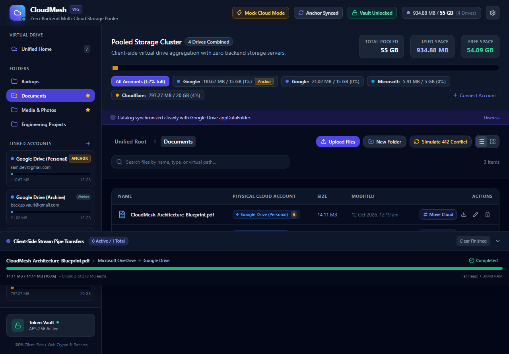

# CloudMesh — Unified Multi-Cloud Storage Manager (SPA)

CloudMesh pools multiple free cloud storage accounts (Google Drive, Microsoft OneDrive, Cloudflare R2 / AWS S3) into a unified virtual drive with **zero backend servers**, streaming transfers client-side and syncing metadata via Google Drive's hidden `appDataFolder`.



---

## 🚀 Key Highlights & Architecture

- **100% Client-Side Architecture**: Built with React 19, TypeScript, and Vite. Static build deployed to Vercel or Cloudflare Pages with zero server dependencies.
- **Local Virtual File System (Dexie.js IndexedDB)**: Persistent high-speed index with compound indexes (`[parentPath+name]`) for instantaneous folder traversal and client-side searching.
- **Google Drive `appDataFolder` Catalog Sync**: Uses native browser `CompressionStream('gzip')` and `DecompressionStream('gzip')` to compress `catalog.json.gz`. Implements **Optimistic Locking** via `If-Match` ETags with automated timestamp merging upon HTTP 412 conflicts.
- **Encrypted Token Vault (Native Web Crypto API)**: Master Password derives an AES-GCM 256-bit key via PBKDF2 (100,000 iterations, SHA-256) through `window.crypto.subtle`. Refresh tokens and secrets are stored in encrypted `vault.enc`.
- **Client-Side Chunk Streaming Engine**: Streams transfers between accounts in fixed 8 MB chunks via browser `ReadableStreamDefaultReader`—keeping the tab memory footprint flat (< 30 MB heap). Automatically requests Screen Wake Lock (`navigator.wakeLock.request('screen')`) during active transfers with pause, resume, and cancel capabilities.
- **Interactive Mock Cloud Mode**: Pre-seeded demo state (Google Drive Anchor, Google Drive Worker, OneDrive Worker, Cloudflare R2 Worker pooling 55 GB) allowing full testing of transfers, chunk pipes, vault encryption, and 412 conflict resolution without API keys.

---

## 📂 Core Architecture Modules

### 1. Module A: Local VFS & Database (`src/services/db.ts`)
- Database: `CloudMeshDB` (IndexedDB via Dexie.js v4)
- Schemas:
  - `accounts`: `id, provider, email, role (anchor | worker), totalCapacity, usedCapacity, connectedAt`
  - `files`: `id, accountId, remoteId, name, virtualPath, parentPath, sizeBytes, mimeType, isFolder, modifiedAt, etag, [parentPath+name]`
  - `transfers`: `id, fileId, fileName, sourceAccountId, targetAccountId, bytesTransferred, totalBytes, status, progressPercentage`
  - `meta`: `key, value`
  - `fileBlobs`: `fileId, blob, updatedAt`

### 2. Module B: Anchor Account & appDataFolder Sync (`src/services/catalogSyncService.ts`)
- Designates primary Google Drive account as the "Anchor".
- Compresses/decompresses metadata with native `CompressionStream('gzip')` and `DecompressionStream('gzip')`.
- Handles optimistic locking with `If-Match` ETags. When HTTP 412 occurs, performs timestamp reconciliation (newest `modifiedAt` wins) and re-commits the merged catalog.

### 3. Module C: Encrypted Token Vault (`src/services/cryptoService.ts`)
- PBKDF2 key derivation (100k rounds, 16-byte random salt, SHA-256).
- AES-256-GCM encryption with 12-byte random IV.
- Vault verification canary for instant password validity checks without leaking token contents.
- Zero plaintext credentials stored in browser storage.

### 4. Module D: Client-Side Chunk Streaming Engine (`src/services/streamingTransferService.ts`)
- Fixed 8 MB chunk streaming (`CHUNK_SIZE = 8 * 1024 * 1024`).
- Stream piping using `ReadableStream` and `ReadableStreamDefaultReader` keeping tab memory usage under 30 MB.
- Screen Wake Lock API integration (`navigator.wakeLock.request('screen')`).
- Cancelable and resumable chunk tracking with `AbortController` and Dexie persistent transfer tasks.

### 5. Module E: Cloud Integrations & Mock Dev Mode (`src/services/cloudProviderService.ts`, `src/services/oauthService.ts`)
- OAuth 2.0 PKCE flow logic (code verifier + SHA-256 code challenge) with BroadcastChannel popup callback handling.
- Toggle between interactive Mock Cloud Mode and Live API Mode.

---

## 🛠️ Development & Production

```bash
# Install dependencies
npm install

# Start Vite development server
npm run dev

# Run TypeScript compilation & production build
npm run build
```
